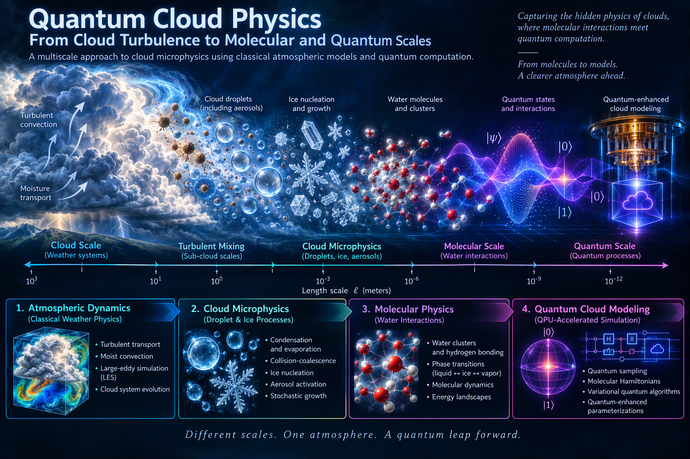
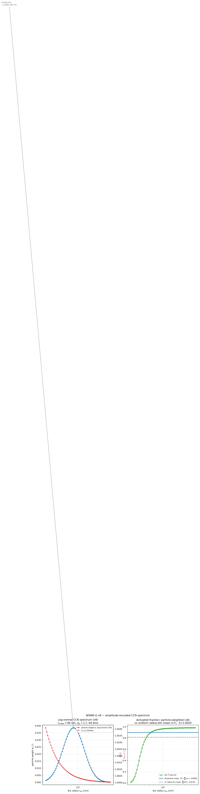
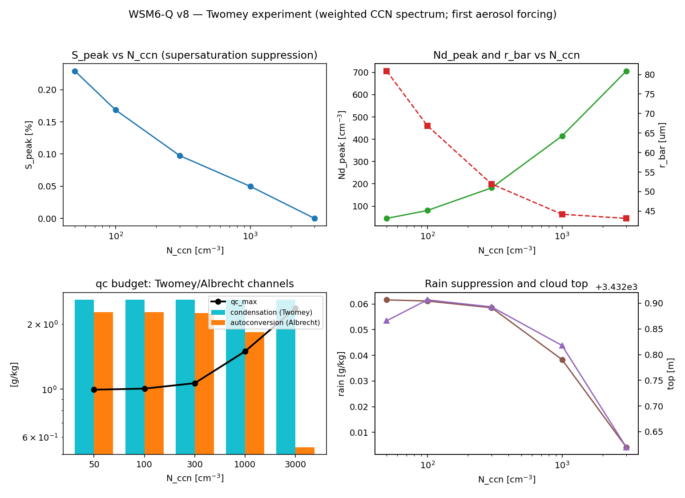
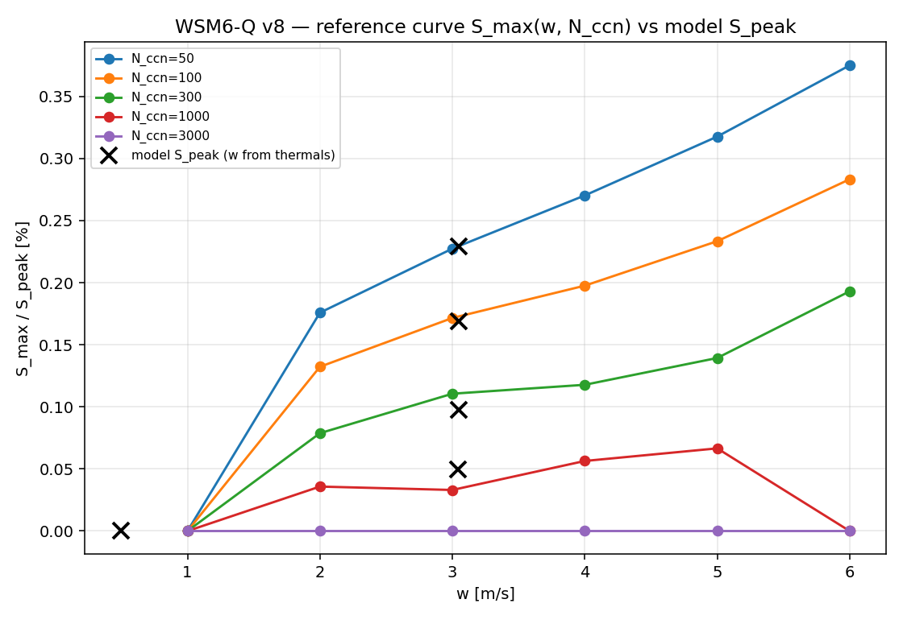

# WSM6-Q — Quantum-Assisted Convective Cloud Model (v8)

**A one-dimensional parcel model of a convective cloud with classical thermodynamics
and microphysics, in which exactly one component is quantum: an estimator of the mean
activated fraction ⟨fᵢ⟩ over the aerosol (CCN) spectrum.**

Everything else — pseudo-adiabatic parcel ascent, buoyancy feedback, A&G-inspired
prognostic activation, condensation, autoconversion and rainout — is classical
convective physics, exactly as in real WRF/ICON/IFS schemes. The quantum accelerator
(if one existed) would plug into precisely the spot this model highlights: the expensive
averaging over the CCN spectrum.
---



## What changed in v8 (the only scientific change)

In v7 and earlier the activated fraction was averaged **uniformly over radius bins**

    ⟨f⟩ = (1/N) Σᵢ fᵢ

which gave a 20 nm bin and a 500 nm bin equal weight, even though in the atmosphere
the extreme bins hold far fewer particles than the vicinity of the mode.

v8 replaces this with the **particle-population weighted mean** over a log-normal CCN
spectrum:

    ⟨f⟩ = Σᵢ wᵢ fᵢ / Σᵢ wᵢ,   wᵢ ∝ exp( −[ln(rᵢ/r_mode)]² / (2 ln²σ_g) )

The quantum state is no longer the uniform superposition `(1/√N) Σᵢ |i⟩` but

    |ψ⟩ = Σᵢ √wᵢ |i⟩

— the amplitudes encode the real aerosol spectrum. Measuring the ancilla then returns
the physically correct mean directly: `P(a=1) = Σᵢ wᵢ fᵢ`.

> At S = 1.002, T = 295 K the particle-weighted mean is **0.8966** while the old
> radius-bin mean is **0.8126** — a ~10 % shift that changes the droplet concentration
> N_d and hence the whole microphysics downstream.



*Left: log-normal CCN particle weights wᵢ (blue) and the Köhler critical supersaturation
S_crit(i) (red) over 64 dry-radius bins. Right: the per-bin activated fraction fᵢ(S,T);
the v8 particle-weighted mean (blue) vs the v7 uniform radius-bin mean (grey dashed).*

---

## Physics pipeline

```
 Thermodynamics (CLASSICAL)
 |-- environment profile θ_env(z), qv_env(z)  ->  CAPE / CIN / LFC
 |-- parcel model: dT/dt (pseudo-adiabat), z(t), w(t)
 |-- buoyancy B = g (θ_v,p − θ_v,env)/θ_v,env
 |-- dw/dt = B − ε w   (effective drag, τ_drag)  ->  feedback loop: latent heat → T → B → w → S

 CCN activation (CLASSICAL + quantum mean estimator)
 |-- log-normal aerosol spectrum, N = 2^N_IDX dry-radius bins
 |-- κ-Köhler: S_crit(i), r_crit(i)   [Petters & Pruppacher]
 |-- A&G-inspired prognostic activation (Abdul-Razzak & Ghan 1995):
 |     dS/dt = adiabatic supply(z, w) − vapor competition(S, N_d, r̄)
 |   irreversible activation: a bin activates once S > S_crit(i)
 |-- f(S,T) = ⟨fᵢ⟩ — THE ACTIVATED-FRACTION MEAN — THE ONLY QUANTUM SPOT
 |     (v8: particle-weighted ⟨fᵢ⟩ = Σ wᵢ fᵢ; state Σ √wᵢ |i⟩; IAA m=0 in the loop)
 |-- N_d = N_ccn · f  ->  cloud droplet number concentration (prognostic)

 Cloud microphysics (CLASSICAL, dependence on N_d → Twomey effect)
 |-- condensation (Fuchs–Stevens, bulk: dq_c/dt ~ S·N_d·r̄)
 |     -> TWOMEY channel: larger N_d = more total droplet surface area = faster growth
 |-- autoconversion: threshold Q_CRIT(N_d) + collision efficiency E(r̄)
 |     -> ALBRECHT channel: larger N_d = less rain (precipitation suppression)
 |-- accretion (q_r collects q_c), sedimentation / rainout of q_r
```

---

## The quantum component — precisely what it is (and is not)

- **Estimator:** Iterative Amplitude Amplification (IAA) at m = 0, shot-based. The
  ancilla probability `P(a=1)` equals the spectrum mean `Σᵢ wᵢ fᵢ`.
- **State preparation:** recursive amplitude encoding (MSB→LSB) builds
  `|ψ⟩ = Σᵢ √wᵢ |i⟩`; cost is N−1 rotations + O(N) X gates. Verified by self-test [T11]:
  max |P(i) − wᵢ| < 1e−12 across all bins.
- **Decoding:** full QAE decoding (m = 0…3) is used **only for diagnostics/verification**
  and does not speed up the model.
- **Honest scope:** this is a *spectrum-mean estimator*, not a speedup of regression or
  microphysics. Its advantage over classical summation applies in an oracle model where
  each fᵢ is expensive to compute (the full version uses an arithmetic oracle that
  computes S_crit(i) from |i⟩).

---

## Results

### 1. Twomey experiment — the first aerosol forcing (`--twomey`)

Sweeping the CCN number concentration from 50 to 3000 cm⁻³ through the full parcel model:

| N_ccn [cm⁻³] | S_peak [%] | N_d,peak [cm⁻³] | r̄ [µm] | q_c,max [g/kg] | condensation [g/kg] | autoconversion [g/kg] | rain [g/kg] |
|:---:|:---:|:---:|:---:|:---:|:---:|:---:|:---:|
| 50   | 0.229 | 45.0  | 80.9 | 0.996 | 2.591 | 2.277 | 0.0616 |
| 100  | 0.169 | 80.4  | 66.9 | 1.007 | 2.591 | 2.274 | 0.0612 |
| 300  | 0.097 | 182.0 | 52.0 | 1.067 | 2.591 | 2.249 | 0.0585 |
| 1000 | 0.050 | 414.8 | 44.2 | 1.497 | 2.591 | 1.842 | 0.0384 |
| 3000 | ~0    | 706.1 | 43.1 | 2.370 | 2.591 | 0.539 | **0.0042** |



Reading the figure:
- **Supersaturation suppression:** more CCN → each droplet grows less → S_peak collapses
  from 0.23 % to ~0 (top-left).
- **Droplet size:** N_d rises while the mean radius r̄ falls from 81 µm to 43 µm
  (top-right) — the classic A&G trade-off.
- **Two aerosol-forcing channels** (bottom-left): total condensation (Twomey) stays roughly
  flat, but autoconversion (Albrecht) collapses as r̄ shrinks below the collision threshold.
- **Rain suppression** (bottom-right): rain falls from 0.062 to 0.004 g/kg — a ~15× reduction —
  while the cloud top barely moves. This is the first aerosol forcing in its textbook form.

### 2. Activation physics vs thermal forcing (`--smax`)

The reference curve S_max(w, N_ccn) is computed by classical A&G integration at **constant w**
(no buoyancy/drag), isolating the pure activation response. The model's prognostic S_peak
(w from thermals) is then compared against it at w_at_Speak:



The black ✕ markers (prognostic S_peak) lie on the classical reference curves for each N_ccn,
confirming that the differential A&G-inspired scheme reproduces the asymptotic activation
physics once the thermal forcing is accounted for.

---

## File layout

| File | Role |
|:---|:---|
| `wsm6_quantum_v8.py` | **The model** — parcel + A&G-inspired activation + weighted CCN spectrum + Twomey/Albrecht microphysics + IAA/QAE estimator. Self-contained, no VQE. |
| `vqe_demo.py` | Standalone VQE demo (H₂O–aerosol Ising clusters, 4 qubits) — separated out per the reviewer decision; **not** part of the model. |
| `quantum.py`, `wsm6_quantum_v1…v7.py` | Historical / reference snapshots of earlier iterations. |
| `img/` | Figures referenced by this README. |

---

## Running

```bash
pip install numpy matplotlib        # core (CPU, "mock" backend)
pip install cudaq                   # optional: real CUDA-Q backend for the IAA circuit

python wsm6_quantum_v8.py --selftest              # T1…T11 verification suite
python wsm6_quantum_v8.py --backend mock          # full parcel run (CPU state-vector simulator)
python wsm6_quantum_v8.py --backend cudaq         # IAA on CUDA-Q
python wsm6_quantum_v8.py --twomey                # full Twomey experiment -> twomey_v8.csv + .png
python wsm6_quantum_v8.py --smax                  # S_max(w, N_ccn) reference vs prognostic S_peak

# tune the aerosol / forcing
python wsm6_quantum_v8.py --nccn 3000 --duration 2400
python wsm6_quantum_v8.py --r-mode 80 --sigma-g 1.7     # log-normal CCN spectrum
```

Key CLI options: `--backend {auto,cudaq,mock}`, `--shots`, `--n-idx` (spectrum bins = 2^N_IDX),
`--kappa` (hygroscopicity), `--r-mode` / `--sigma-g` (CCN spectrum shape), `--nccn`, `--w0`,
`--drag-tau`, `--duration`, `--dt`.

---

## Verification (`--selftest`)

The suite checks the quantum and classical pieces independently:

| Test | Checks |
|:---|:---|
| T1  | IAA m=0 on the weighted state: P(a=1) = Σ wᵢ fᵢ (the v8 core) |
| T2  | Grover/QAE diffuser reflection about the weighted state (m = 1,2,3) |
| T3  | QAE decoder recovers f from {p(m)} |
| T4 / T4b | MCX/MCZ and multi-control CRY decompositions == native version on the full state vector (protects the CUDA-Q backend) |
| T5  | Köhler: S_crit decreases with r_dry; realistic CCN values |
| T6  | Environment profile: LFC in the BL, CAPE > 0, Γ_d ≈ 9.5 K/km, cap-base RH < 95 % |
| T7  | A&G competition: larger N_ccn → lower S_peak; N_d < N_a |
| T8  | Twomey: at fixed q_c, larger N_d → smaller autoconversion flux |
| T9  | Mass balance over a full parcel run (err ≪ 2 %) |
| T10 | CCN weights: Σw = 1, peak at r_mode; weighted mean ≠ radius-bin mean; S_max(100) > S_max(3000) |
| T11 | Amplitude encoding: \|ψᵢ\|² = wᵢ for **all** bins (max error < 1e−12) |

Latest run: **ALL PASSED.**

---

## Honest limitations

- A single, one-dimensional parcel — no horizontal transport, turbulence or advection; drag is
  an effective parameter (τ_drag), not LES.
- Activation is a scheme *inspired by* Abdul-Razzak & Ghan (1995) in differential form
  (S as the state variable), not the asymptotic formula S_max(N_a, w); the reference curve is
  computed separately (`--smax`) for comparison. Requires dt_sub = 0.5 s.
- Autoconversion is a parameterization (threshold + E(r̄)), not a spectral collision model.
- The quantum part estimates the **weighted mean** ⟨fᵢ⟩ = Σ wᵢ fᵢ (log-normal particle weights;
  state Σ √wᵢ |i⟩; IAA m=0). It is a spectrum-mean estimator, not a speedup of regression /
  microphysics; QAE decoding is diagnostic only.

---

## References

- Abdul-Razzak, H. & Ghan, S. J. (1995). A parameterization for activation of aerosols as cloud
  condensation nuclei. *Q. J. R. Meteorol. Soc.* **121**, 67–83.
- Petters, M. D. & Pruppacher, H. R. (2007). A revision of the Köhler theory for water activity
  and curvature... *J. Atmos. Sci.* **64**, 295–308.
- Twomey, S. (1959); Albrecht, B. A. (1989). The first aerosol forcing.
- Grover (1998); amplitude amplification and quantum amplitude estimation (QAE).
